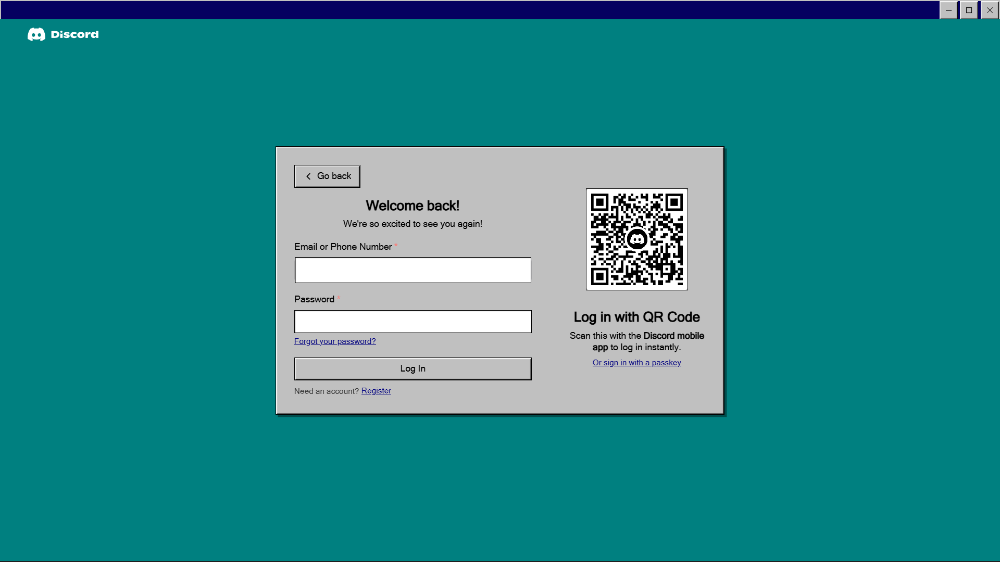
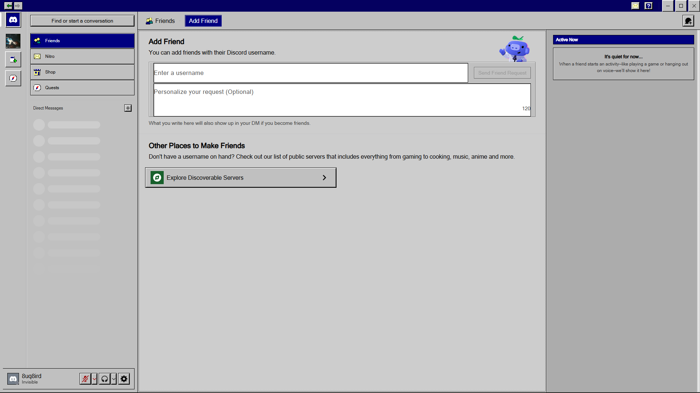
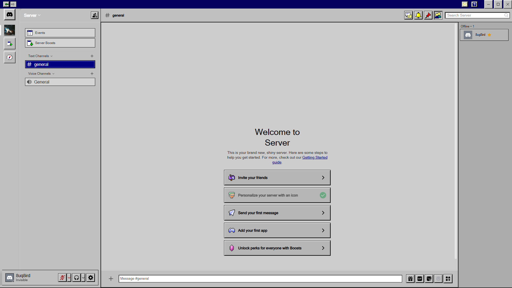

  

A Windows 98-inspired theme for BetterDiscord.

Classic 98 brings the Windows 98 look to Discord with classic gray windows, beveled controls, and blue title bars.

 

> [!WARNING]
> **Future Discord client compatibility**
>
> Discord has announced plans to replace its Electron desktop client with a native Rust client. Classic 98 relies on BetterDiscord and the current interface’s HTML and CSS, so compatibility with the replacement is not guaranteed.
>
> Future support will depend on available theming tools and the new client’s interface. Significant changes to the theme may be required.
>
> Classic 98 has not been discontinued. This notice concerns future compatibility and does not indicate a current compatibility issue.

 

## Preview

### Login

### Add Friend

### Server

## Installation

1. Download **[`Classic98.theme.css`](Classic98.theme.css)** from this repository.
2. Place the file in your BetterDiscord themes folder.
3. Open Discord and go to **User Settings → Themes**.
4. Enable **Classic 98**.

## Feedback & Contributing

For bugs, unexpected behavior, or edge cases, open an [Issue](https://github.com/8ug8ird/98-Classic-Theme//issues).

Feature requests and implementation-related changes can be submitted through [Pull Requests](https://github.com/8ug8ird/98-Classic-Theme//pulls).

 

> [!WARNING]
> BetterDiscord modifies the Discord client, which is not permitted under Discord's Terms of Service. Use at your own risk.

 

MIT © [8ug8ird](https://github.com/8ug8ird)
